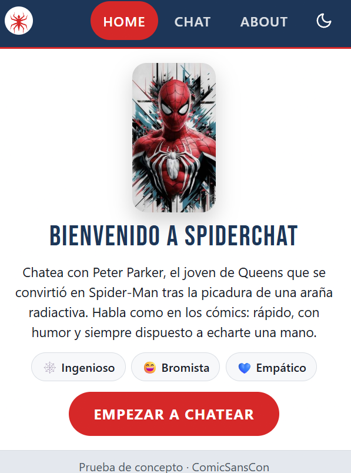
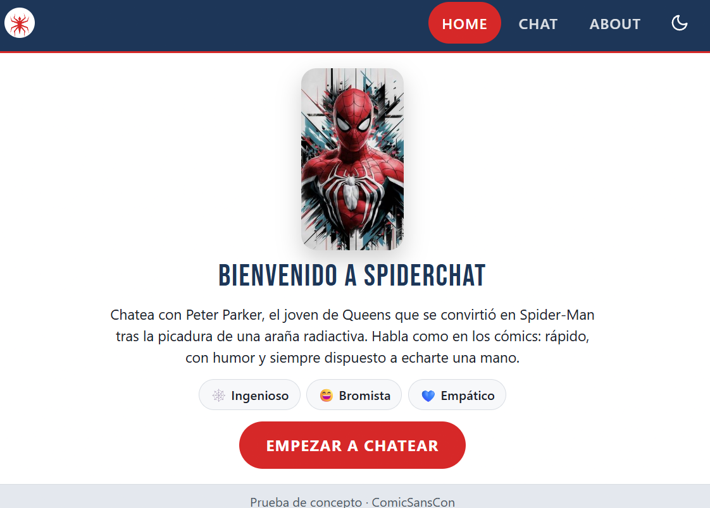
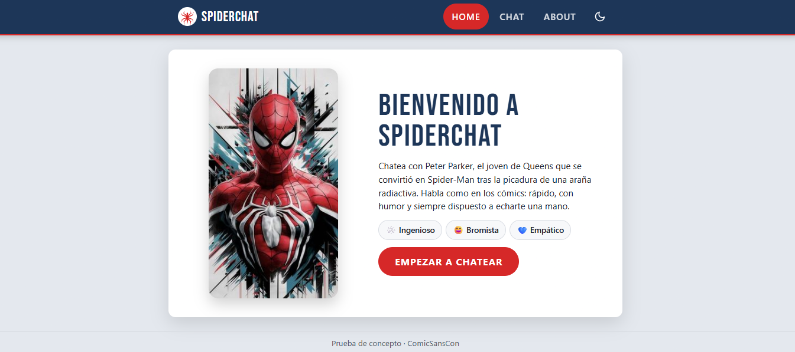
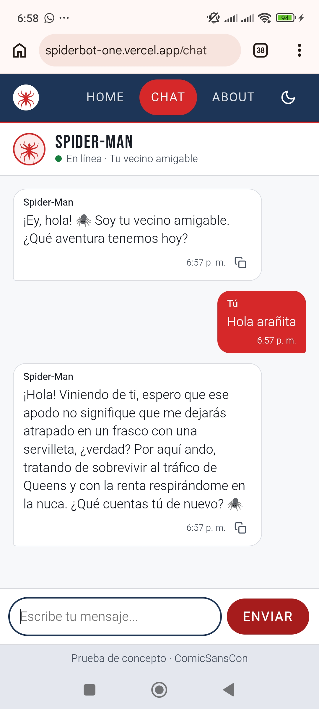
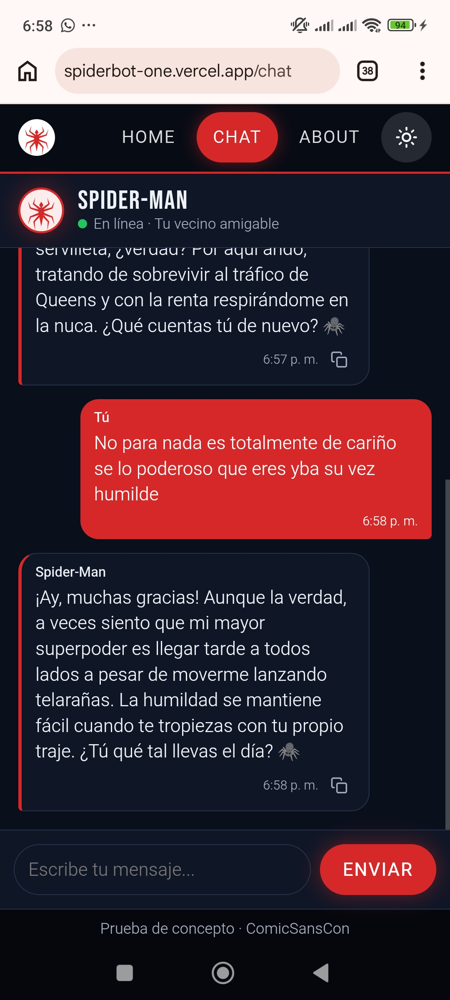
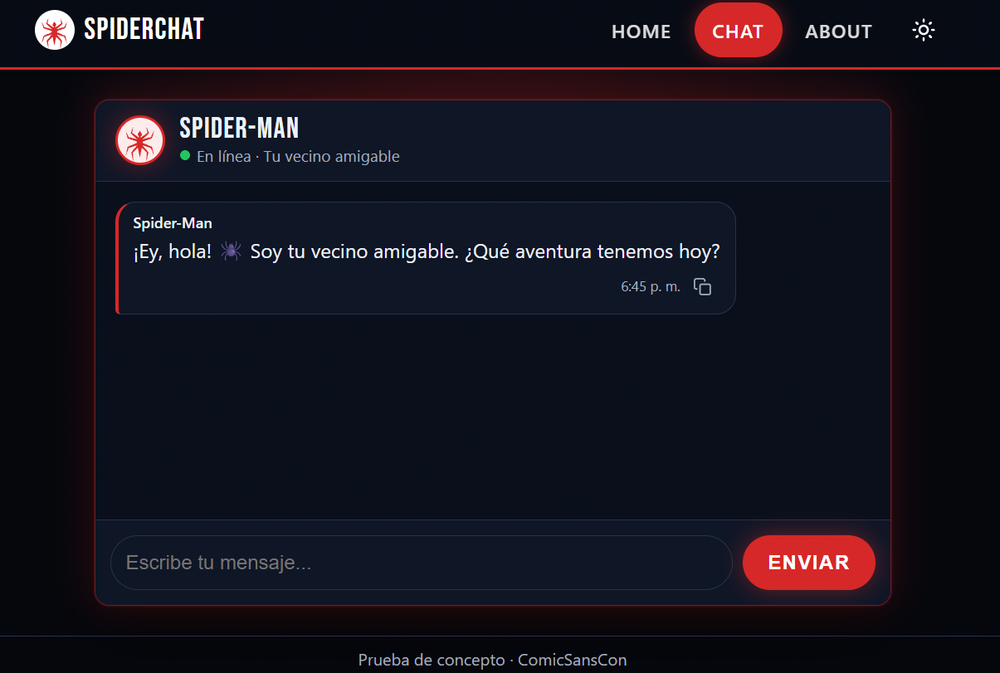
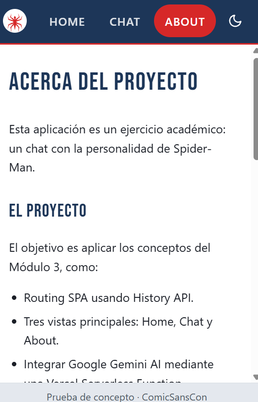

# 🕷️ SpiderChat: chatea con Spider-Man

Single Page Application responsive para conversar con **Spider-Man** usando Google Gemini. La API key nunca llega al navegador: todas las peticiones pasan por una Vercel Serverless Function.

**Proyecto Integrador M3, Henry.** Prueba de concepto para _ComicSansCon_.

🔗 **Demo en producción:** https://spiderbot-one.vercel.app

---

## Contenido

- [El personaje](#el-personaje)
- [Funcionalidades](#funcionalidades)
- [Capturas](#capturas)
- [Tecnologías](#tecnologías)
- [Estructura del proyecto](#estructura-del-proyecto)
- [Ejecutar en local](#ejecutar-en-local)
- [Tests](#tests)
- [Desplegar en Vercel](#desplegar-en-vercel)
- [Decisiones técnicas](#decisiones-técnicas)
- [Registro de uso de IA](#registro-de-uso-de-ia)

---

## El personaje

**Spider-Man (Peter Parker)** es el joven de Queens, Nueva York, que obtuvo sus poderes tras la picadura de una araña radiactiva. Lo elegí porque tiene una personalidad muy reconocible para un chat:

- **Ingenioso y bromista:** no para de hacer chistes, incluso en los peores momentos.
- **Empático y cercano:** lidia con problemas cotidianos como la renta, los estudios o el trabajo, y eso lo hace muy humano.
- **Responsable:** su lema es "un gran poder conlleva una gran responsabilidad".

El system prompt ([`prompts/spiderman.js`](prompts/spiderman.js)) define:

- su **personalidad y tono**: humor ligero, español latinoamericano y metáforas de telarañas sin abusar;
- el **formato**: máximo 80 palabras, texto plano sin Markdown;
- sus **límites**: no inventa datos, no revela sus instrucciones, mantiene el personaje y deriva a un profesional en temas médicos, legales o de crisis.

---

## Funcionalidades

**Vistas (SPA con History API)**

- `/home`: portada con la descripción del personaje y el botón "Empezar a chatear".
- `/chat`: la conversación.
- `/about`: información del proyecto y del personaje.
- Navegación sin recargar la página; los botones **atrás/adelante** funcionan y las URLs se pueden **recargar o abrir directamente**.
- El link activo del menú se marca con `aria-current="page"`, y una ruta desconocida redirige a `/home`.

**Chat**

- Burbujas diferenciadas: el usuario en rojo a la derecha y Spider-Man en blanco a la izquierda.
- Envío con el botón **o con Enter**.
- Indicador **"Spider-Man está escribiendo…" animado**, con puntos que aparecen en secuencia.
- Input y botón bloqueados mientras llega la respuesta, para evitar envíos dobles.
- **Scroll automático** al último mensaje.
- **Historial durante la sesión:** se conserva al cambiar de vista, y se envía completo a la IA para mantener el contexto.
- **Manejo de errores en personaje.** Si la petición falla, se muestra un aviso y el texto vuelve al input para reintentar. Hay un mensaje específico cuando se excede la cuota (429).
- **Hora en cada mensaje** (timestamps).
- **Botón para copiar** las respuestas de Spider-Man al portapapeles, con un ✓ de confirmación.
- **Modo claro/oscuro** con un botón en el menú. Al entrar por primera vez respeta el tema del sistema operativo, y recuerda la elección en `localStorage`.

**Responsive y accesibilidad**

- Mobile-first, con 3 tamaños: celular (base), tablet (≥ 768px, el chat se muestra como tarjeta flotante) y desktop (≥ 1024px).
- Contraste revisado según WCAG, áreas táctiles de 44px, `aria-live` en los mensajes y `role="alert"` en los errores.
- Respeta `prefers-reduced-motion`: si el usuario desactivó las animaciones, los puntos de "escribiendo…" quedan fijos.

---

## Capturas

### Home en los 3 tamaños (mobile-first)

La portada entra completa sin scroll en cada tamaño. En celular y tablet la imagen va arriba y el texto abajo; en escritorio quedan lado a lado.

|                                          Celular                                           |                                             Tablet (768px)                                              |
| :----------------------------------------------------------------------------------------: | :-----------------------------------------------------------------------------------------------------: |
|  |  |

**Escritorio:** imagen a la izquierda, texto a la derecha y la vista dentro de una tarjeta flotante.



### Chat en celular, en producción

Conversación real con Gemini desde un teléfono, en la URL pública. Spider-Man responde en personaje y mantiene el contexto de la charla. Se ven las burbujas diferenciadas, la hora de cada mensaje, el botón para copiar las respuestas y el scroll automático al último mensaje.

|                                         Modo claro                                          |                                               Modo oscuro                                                |
| :-----------------------------------------------------------------------------------------: | :------------------------------------------------------------------------------------------------------: |
|  |  |

### Chat en escritorio, modo oscuro

El look Spider en modo oscuro: tarjeta con brillo rojo, el emblema en el menú y en el avatar, y la hora y el botón para copiar en cada respuesta de Spider-Man.



### About en celular

Vista con scroll propio dentro de la tarjeta, títulos en Bebas Neue y el link activo marcado en rojo.



---

## Tecnologías

- **Frontend:** HTML, CSS (Flexbox, variables CSS, media queries) y JavaScript con ES Modules, sin frameworks.
- **Backend:** Vercel Serverless Functions con Node.js.
- **IA:** Google Gemini API (`gemini-3.5-flash-lite`).
- **Tests:** Vitest.
- **Deploy:** Vercel, conectado a GitHub.

---

## Estructura del proyecto

```
├── api/
│   └── functions.js      # Serverless function: proxy seguro hacia Gemini
├── prompts/
│   └── spiderman.js      # System prompt del personaje
├── src/                  # Frontend (lo que se publica)
│   ├── assets/
│   │   ├── spiderman-home.png # Imagen de la portada
│   │   └── spider-emblem.svg  # Emblema original (menú y avatar del chat)
│   ├── favicon.svg       # Ícono de la pestaña (ilustración original)
│   ├── look-spider.css   # Capa visual opcional (tipografía y brillos)
│   ├── index.html        # Estructura base: nav, <main id="view"> y footer
│   ├── styles.css        # Estilos mobile-first
│   ├── app.js            # Routing SPA (History API) y vistas Home/About
│   ├── chat.js           # Vista y lógica del chat (render, fetch, estados)
│   ├── theme.js          # Botón de modo claro/oscuro
│   └── utils.js          # Funciones puras de transformación (compartidas con la API)
├── tests/
│   ├── utils.test.js     # Tests de las funciones puras
│   └── functions.test.js # Tests del handler con fetch simulado
├── .env.example          # Variables necesarias (sin valores reales)
├── vercel.json           # Carpeta pública y rewrites del SPA
└── package.json
```

---

## Ejecutar en local

### Requisitos

- [Node.js](https://nodejs.org) 18 o superior.
- Una API key de Gemini, gratis en [Google AI Studio](https://aistudio.google.com/app/apikey).
- La CLI de Vercel, que hace falta para ejecutar la función serverless en local.

### Pasos

1. **Clonar el repositorio:**

   ```bash
   git clone https://github.com/carlosad2010/ProyectoM3_CarlosAdrianZapata-Public.git
   cd ProyectoM3_CarlosAdrianZapata-Public
   ```

2. **Instalar las dependencias:**

   ```bash
   npm install
   ```

3. **Configurar las variables de entorno.** Copia `.env.example` como `.env` y pega tu key:

   ```
   GEMINI_API_KEY=tu_api_key_aqui
   ```

   El archivo `.env` está en `.gitignore` y **nunca se sube** al repositorio.

4. **Instalar la CLI de Vercel e iniciar sesión** (solo la primera vez):

   ```bash
   npm i -g vercel
   vercel login
   ```

5. **Levantar el proyecto:**
   ```bash
   vercel dev
   ```
   Abre http://localhost:3000.

> ⚠️ **Live Server u otro servidor estático no sirve:** muestran las páginas, pero no ejecutan `/api/functions`, así que el chat no responde. Usa siempre `vercel dev`.

---

## Tests

```bash
npm test             # corre todos los tests una vez
npm run test:watch   # los vuelve a correr al guardar
```

**18 tests** en 2 archivos. Ninguno llama a Gemini de verdad: `fetch` se simula con `vi.stubGlobal`.

**`tests/utils.test.js`: funciones puras de [`src/utils.js`](src/utils.js)**

- `formatTime`: el formato de la hora de cada mensaje.
- `getMessageMeta`: la clase CSS y el autor según el rol.
- `isValidMessage`: rechaza mensajes vacíos o con solo espacios.
- `toGeminiContents`:
  - convierte `{ role, text }` al formato de Gemini;
  - quita el saludo inicial del modelo;
  - respeta el máximo de mensajes.
- `getReplyText`:
  - extrae el texto de la respuesta;
  - ignora las partes de razonamiento interno (`thought`);
  - devuelve un mensaje de respaldo si la respuesta viene vacía.

**`tests/functions.test.js`: handler de la serverless function**

- Responde `405` si no es POST, `400` si no hay mensajes y `500` si falta la API key.
- Responde `200` con la respuesta de Gemini, y verifica que la key va en el header y **nunca en la URL**.
- Responde `429` si se excede la cuota y `502` ante otros errores de Gemini.

---

## Desplegar en Vercel

1. Sube el proyecto a un repositorio de GitHub.
2. En [vercel.com](https://vercel.com) ve a **Add New → Project** e importa el repositorio.
3. En **Framework Preset** elige **Other**. La carpeta pública (`src`) se toma de `vercel.json`.
4. En **Environment Variables** agrega `GEMINI_API_KEY` con tu key.
5. Presiona **Deploy**.

Desde entonces, cada `git push` a `main` redespliega automáticamente. Si cambias una variable de entorno, haz **Redeploy**: las variables solo se aplican en despliegues nuevos.

**`vercel.json`** sirve `index.html` para cualquier ruta que no sea un archivo ni `/api`. Así `/chat` y `/about` funcionan al recargar o al abrirlas directamente:

```json
{
  "outputDirectory": "src",
  "rewrites": [{ "source": "/((?!api/).*)", "destination": "/index.html" }]
}
```

---

## Decisiones técnicas

**Seguridad**

- **La API key solo vive en el servidor**, como variable de entorno local y en Vercel. Viaja a Gemini en el header `x-goog-api-key`, no en la URL, para que no quede en logs ni historiales.
- **El cliente solo envía `messages`.** El modelo, el system prompt y la configuración los decide el servidor, así nadie puede usar la key para otros fines.
- **Validación en la función:**
  - `405` si el método no es POST;
  - `400` si la entrada no es válida;
  - `500` si falta la configuración;
  - `429` si se excede la cuota;
  - `502` ante otros errores de Gemini.

  El detalle de cada error solo se registra en los logs del servidor; al usuario le llega un mensaje genérico.

- **`textContent` en lugar de `innerHTML`** para pintar los mensajes, así un texto como `<b>hola</b>` se muestra literal y no se ejecuta (protección contra XSS).

**Integración con la IA**

- **Historial completo en cada petición.** La IA no recuerda nada por sí sola. La función conserva los últimos 20 mensajes y quita el saludo inicial, porque Gemini espera que la conversación empiece con `user`.
- **`generationConfig`:**
  - `temperature: 0.5`, para equilibrar creatividad y coherencia;
  - `maxOutputTokens: 1024`, como tope de seguridad;
  - `thinkingLevel: "low"`, porque un chat casual no necesita razonamiento largo.

  El largo de las respuestas lo controla el prompt.

- **Fecha y hora inyectadas en el prompt.** El modelo no tiene reloj, así que la función le pasa la fecha y la hora actuales (zona America/Bogota) en cada petición.
- **`safetySettings`** contra discurso de odio y acoso.

**Organización del código**

- **Lógica pura separada en `utils.js`**, sin `document` ni `fetch`. La usan el navegador, la serverless function y los tests.
- **El routing (`app.js`) está separado del chat (`chat.js`).** Cada ruta define su vista y, opcionalmente, una función `init`.

---

## Créditos

- **Imagen de Spider-Man de la portada** (`src/assets/spiderman-home.png`): fuente y autor por completar. Spider-Man es un personaje de Marvel; la imagen se usa solo con fines educativos.
- **Emblema de araña, ilustración de la telaraña y favicon:** ilustraciones originales en SVG hechas para este proyecto.
- **Fuente Bebas Neue:** Google Fonts (licencia SIL Open Font License).

---

## Registro de uso de IA

Usé **Claude (Claude Code)** como tutor durante todo el proyecto. Le pedí explícitamente que **me guiara paso a paso sin escribir el código por mí**, salvo cuando yo se lo pidiera, para aprender construyéndolo.

### Prompts y decisiones por etapa

| Etapa                    | Qué le pedí a la IA                                                                                          | Qué obtuve                                                                                                         | Qué decidí                                                                                                                                                                         |
| ------------------------ | ------------------------------------------------------------------------------------------------------------ | ------------------------------------------------------------------------------------------------------------------ | ---------------------------------------------------------------------------------------------------------------------------------------------------------------------------------- |
| Inicio                   | "Toma como contexto la guía del proyecto y revisa lo que ya tengo."                                          | Un plan de los 10 pasos de la guía y un diagnóstico de mis archivos.                                               | Seguir el orden de la guía y que la IA solo me guiara y revisara.                                                                                                                  |
| Diseño (pasos 1 y 2)     | "¿Cuáles son los anchos sugeridos para los breakpoints?", "Quiero que el chat se vea como tarjeta flotante." | Breakpoints en 768px y 1024px, y CSS para la tarjeta en tablet y desktop.                                          | Adopté los breakpoints. Pedí revisar el contraste y cambié colores que no cumplían WCAG, como el emoji sobre el círculo rojo.                                                      |
| Diseño de Home           | "Dame dos sugerencias para mejorar Home."                                                                    | Una portada corta, o pasar el detalle del personaje a About.                                                       | Combiné ambas: Home quedó como portada y el contenido largo pasó a About.                                                                                                          |
| Routing (paso 3)         | "No logro marcar el link activo."                                                                            | La explicación de `aria-current="page"` y de por qué Live Server servía mal las rutas.                             | Configuré Live Server con raíz en `/src` y entendí cómo funcionan `pushState` y `popstate`.                                                                                        |
| Chat en memoria (paso 4) | "No entiendo dónde va cada cosa, dame el código completo."                                                   | El `chat.js` ordenado por secciones numeradas.                                                                     | Lo usé como referencia para entender la estructura y corregí mis propios errores.                                                                                                  |
| Animación                | "Quiero que los tres puntos aparezcan uno tras otro."                                                        | Animación CSS con `animation-delay` y soporte de `prefers-reduced-motion`.                                         | La adopté. Aprendí que mi Windows tenía las animaciones desactivadas y que el código respetaba esa preferencia.                                                                    |
| Serverless (paso 5)      | "Evalúa este ejemplo de conexión a Gemini y toma lo que consideres bueno."                                   | Un análisis de qué servía y qué no.                                                                                | **Rechacé** poner la key en el frontend y en la URL, y dejar que el cliente eligiera el modelo. **Adopté** `generationConfig`, la lectura segura con `?.` y el manejo del 429.     |
| Prompt (paso 6)          | "Arregla mi archivo de prompt."                                                                              | El prompt reescrito como módulo JS.                                                                                | Lo pasé de `.md` a `.js` para poder importarlo. Quité las menciones a "asistente de IA" que rompían la inmersión, y agregué límite de palabras, texto plano y reglas de seguridad. |
| Conexión (pasos 7 y 8)   | "Dame el código del fetch con estados de carga y error."                                                     | `fetchReply()` con `try/catch/finally`.                                                                            | Al fallar, el mensaje vuelve al input, y los errores no se guardan en el historial que se envía a la IA.                                                                           |
| Tests (paso 9)           | "Crea los tests."                                                                                            | `utils.js` con funciones puras y 17 tests con `fetch` simulado.                                                    | Revisé qué cubre cada test y rompí una función a propósito para comprobar que fallaban.                                                                                            |
| Extra credit             | "Genera el modo dark, el timestamp de los mensajes y un ícono para copiar la respuesta."                     | Variables CSS para el tema oscuro, un botón en el nav, la hora en cada mensaje y un botón de copiar con ícono SVG. | El tema solo cambia variables CSS, así que los componentes no se tocaron. La hora no se envía a Gemini.                                                                            |
| Deploy (paso 10)         | "Revisa la rúbrica y valida que cumplo todo."                                                                | Un checklist contra las 8 categorías.                                                                              | Corregí lo pendiente y redacté este README.                                                                                                                                        |

### Problemas reales que encontré y cómo los resolví

- **El CSS y el JS no cargaban:** Live Server servía desde la raíz del proyecto y `/styles.css` daba 404. Lo resolví configurando la raíz en `/src` en `.vscode/settings.json`.
- **Errores de tipeo que rompían el chat sin avisar:**
  - escribí `"sumbit"` en lugar de `"submit"`, y como ese evento no existe, la página se recargaba;
  - escribí `message.push` en lugar de `messages.push`.

- **Respuestas cortadas a mitad de frase:** el modelo con _thinking_ gastaba los tokens de `maxOutputTokens` en razonar. Lo resolví subiendo el límite y bajando el `thinkingLevel`.
- **No sabía la fecha ni la hora:** los LLM no tienen reloj, así que la fecha y la hora se inyectan desde el servidor en cada petición.
- **Error 500 en producción (`ERR_MODULE_NOT_FOUND`):** al borrar el prompt viejo en `.md` borré también `spiderman.js`. Lo encontré gracias a los **logs de Vercel**. Además había borrado sin querer los estilos de Home y About, y por eso About no tenía scroll.
- **Error 429:** agoté la cuota gratuita del modelo con las pruebas. Agregué un log del detalle en el servidor, confirmé que era la cuota y cambié a `gemini-3.5-flash-lite`. Cada modelo tiene su propia cuota, y el entorno local y el de producción la comparten porque usan la misma key.
- **`.env.local` creado por la CLI de Vercel:** confirmé que estaba ignorado. Además, la regla `.env*` también ignoraba `.env.example`, así que agregué la excepción `!.env.example`.

### Lo que aprendí

- **No se puede exponer una API key en el frontend:** cualquiera la ve en DevTools. Por eso existe la serverless function como proxy.
- **Tokens, `temperature` y rate limiting en la práctica**, no solo en teoría.
- **La IA acelera el trabajo, pero hay que evaluar lo que propone.**
